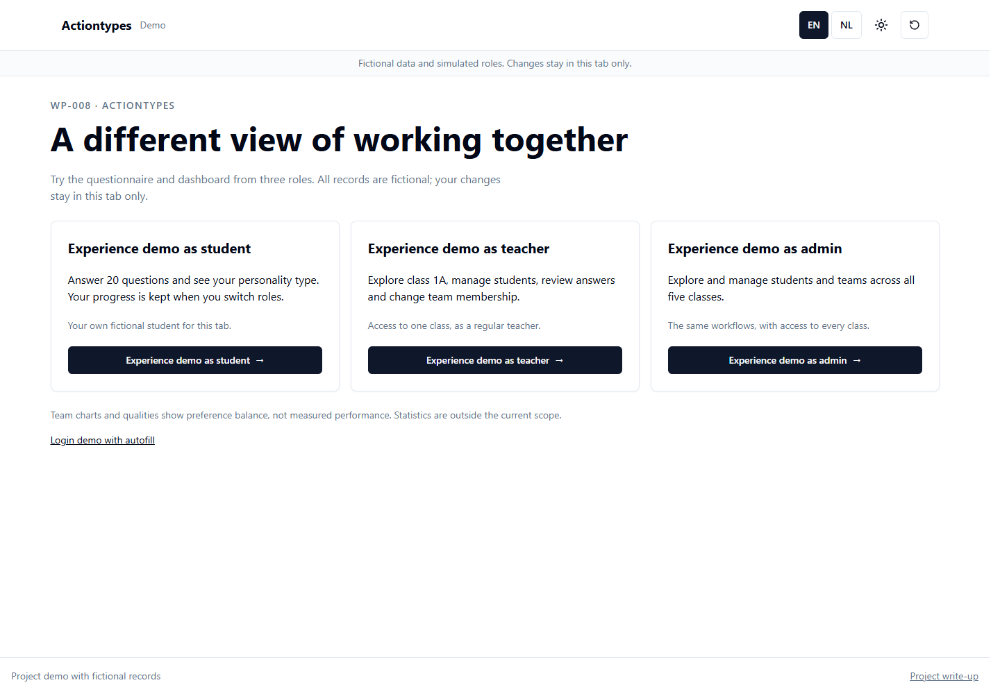

# Actiontypes

A bilingual student questionnaire and teacher/admin demo with class-scoped team management and automatic assignment.

- **Role:** Solo developer
- **Period:** 2024–2026; demo updated 17 November 2026
- **Stack:** Astro, React, TypeScript, Bun, Astro DB, SQLite, Tailwind CSS, shadcn/ui, Lucia
- **Public demo:** [Try Actiontypes](https://demo.jordy.zip/sd/wp-008/) — resettable browser-local version, verified 17 November 2026. The Astro/SQL application remains a separate server reference.

## The original brief

For my WP-3 retake, students needed to answer pairs of statements and get a four-letter personality type. Teachers needed to inspect answers and manage student records. The brief called for a REST API and SQL storage, authenticated teacher pages, resumable questionnaires and protection against duplicate completion.

I started with Flask and SQLite, alongside a React frontend that later became a Next.js app. I wanted to practice frameworks after doing a lot of Flask work in the previous project. I thought my teacher might appreciate the extra effort, even where my choices departed from the brief. I later rebuilt it with Astro and TypeScript, React components and Astro DB. Lucia handles sessions; the interface uses Tailwind and shadcn/ui.

I passed the retake with distinction and kept developing the project. The current demo includes work beyond that assessed version.

## Experiencing the demo

The demo provides English and Dutch interfaces and three entry points:

- **Student:** a fictional visitor record for the browser, with a 20-question questionnaire, saved progress, a result and restart. Progress is retained when switching roles.
- **Teacher:** manages class 1A, including student records, answers, resets, teams and assignment.
- **Admin:** uses the same management workflows across all five classes.

Every visitor can try all three roles. The public demo labels them as simulations: it has no server authentication or database. A deterministic fictional seed becomes the current tab's own copy, with edits and questionnaire progress saved in sessionStorage. Reloading keeps those changes; Reset demo restores the seed in that tab. Other visitors are unaffected. If storage is blocked, the demo works in memory and explains that refreshing discards changes.

The public role simulation shows teachers one class and admins all five. Client-side checks help reproduce the workflow; they are not security controls. The separate Astro server reference enforces real sessions, staff permissions and class ownership in its API. The original login forms remain available as a simulation, with centered cards and demo autofill buttons. Shared shadcn components keep the controls consistent with the existing interface.

## Team assignment and management

The demo now connects automatic assignment to the dashboard. Teachers and admins can create, rename and delete teams, add or move members, remove members, reset a class's assignments and export team data as JSON. Resetting assignments or deleting a team preserves students and their questionnaire answers.

Automatic assignment runs within a class. It spreads the existing four heuristic roles—direction, innovation, implementation and people—and preference letters while keeping team sizes even. It creates missing teams and caps membership at five. Only valid completed types are assigned; other students remain available. The algorithm is deterministic and greedy, rather than a global optimizer or a tested predictor of performance.

## What the charts and qualities mean

The radar keeps the original illustrative 1–5 student profiles and dashed team average, using the original Python/inhaal-wp3 source as reference. Each student's full web is visible in the same color as their member card. Hovering a student brings their web to the front, strengthens its fill and outline, and fades the others; leaving restores the default view. Hovering a web highlights its member, and keyboard focus on a card works too. The webs visualize team balance; their values are illustrative rather than measured intensities. The qualities below continue to use actual type counts.

The qualities panel derives strengths and potential gaps from that composition, with compact color-coded `+`/`++`/`+++` and `-`/`--`/`---` grades for quick scanning. Supporting counts are available on hover. Missing or invalid types are excluded. The rules are documented project heuristics, not validated psychometric thresholds or evidence of a person's skills. This follows the distinction between preferences and abilities in [the Myers & Briggs Foundation's guidance](https://www.myersbriggs.org/type-in-my-life/personality-type-and-organizations/).

The shared qualities/radar feature is also applied to the original Actiontypes source copy. The demo's connected management APIs and role-entry flow remain part of the separate demo version; the original application's database was not modified.

## Fixes and verification

The demo's result calculation now counts each opposing pair separately. The former method of choosing the four most frequent letters could pick both sides of a pair while omitting another. Both versions validate question order and statement pairs. In the server reference, a database unique index also rejects concurrent duplicate answers.

Verification includes 20 passing unit/API/local-store cases and 104 responsive checks on the server reference. The public static build was also tested locally and at its hosted URL: both languages, all roles, the complete questionnaire, student/team edits, assignment, export, reload, independent tabs, reset and storage fallback, with 24 layout checks at 320–1440px. Those workflows issue no website POST, API or external requests and produced no browser errors. The screenshots show the actual static build with fictional records.

## Scope and next questions

Statistics and realistic performance-history data are outside the current scope. A possible later extension is to compare diverse groups with groups of similar personalities, perhaps weighting particular similarities. No second algorithm, tuning controls or outcome tracking is implemented.

Making a team look balanced in code does not establish that its members work better together. Showing the underlying counts makes the current model easier to inspect while leaving that question open.

## Hosting status

The public demo is a static React/Vite build under the existing demo catalog. It reuses the application's components, translations, assignment algorithm and insight model, with an explicit local data transport and hash navigation. No hosted database, new backend, paid plan or service was enabled. The original Astro/Lucia/SQLite application and its API tests remain available separately; publishing the static build does not deploy that server.

A shared Convex backend for multiple demos is a later option; no Convex service has been connected. Statistics and performance-history data remain outside this demo's scope.

[Back to the project list](../../README.md)
