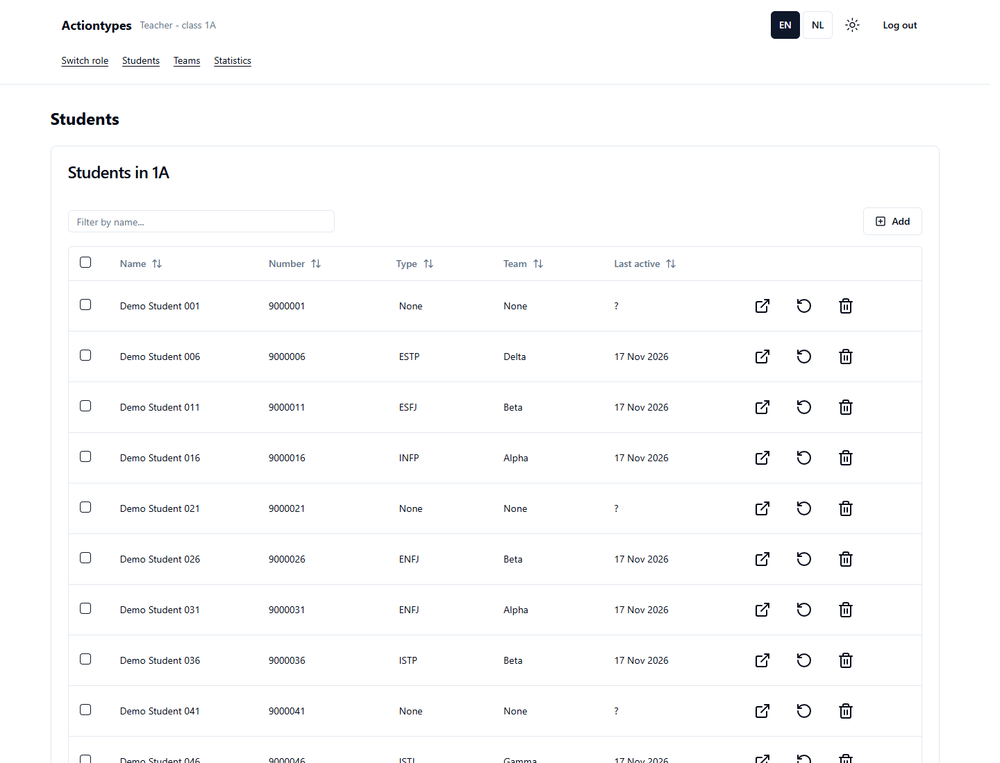
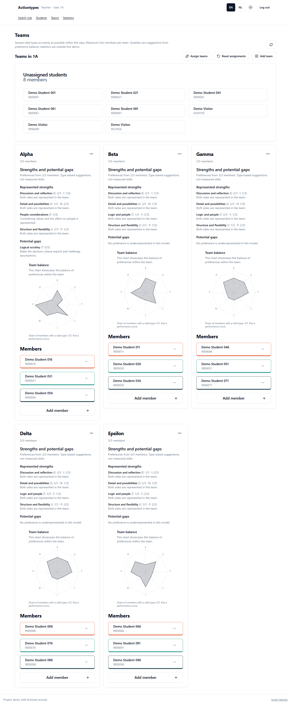

# Actiontypes

A bilingual student questionnaire and teacher/admin demo with class-scoped team management and automatic assignment.

- **Role:** Solo developer
- **Period:** 2024–2026; demo updated 17 November 2026
- **Stack:** Astro, React, TypeScript, Bun, Astro DB, SQLite, Tailwind CSS, shadcn/ui, Lucia
- **Availability:** Demo verified locally; public hosting is being prepared. The screenshots show the current demo, not a live deployment.

## The original brief

For my WP-3 retake, students needed to answer pairs of statements and get a four-letter personality type. Teachers needed to inspect answers and manage student records. The brief called for a REST API and SQL storage, authenticated teacher pages, resumable questionnaires and protection against duplicate completion.

I started with Flask and SQLite, alongside a React frontend that later became a Next.js app. I wanted to practice frameworks after doing a lot of Flask work in the previous project. I thought my teacher might appreciate the extra effort, even where my choices departed from the brief. I later rebuilt it with Astro and TypeScript, React components and Astro DB. Lucia handles sessions; the interface uses Tailwind and shadcn/ui.

I passed the retake with distinction and kept developing the project. The current demo includes work beyond that assessed version.

## Experiencing the demo

The demo provides English and Dutch interfaces and three entry points:

- **Student:** a fictional visitor record for the browser, with a 20-question questionnaire, saved progress, a result and restart. Progress is retained when switching roles.
- **Teacher:** manages class 1A, including student records, answers, resets, teams and assignment.
- **Admin:** uses the same management workflows across all five classes.

The role chooser intentionally lets visitors try each demo role. It creates real sessions for server-selected demo accounts; it is not an access restriction on who may try the admin experience. Only fictional records are used.

The server enforces the teacher's class boundary, including direct API requests. Student sessions cannot use staff APIs. The original login forms remain available, with centered cards and demo autofill buttons. Shared shadcn components keep the new controls consistent with the existing interface.

## Team assignment and management

The demo now connects automatic assignment to the dashboard. Teachers and admins can create, rename and delete teams, add or move members, remove members, reset a class's assignments and export team data as JSON. Resetting assignments or deleting a team preserves students and their questionnaire answers.

Automatic assignment runs within a class. It spreads the existing four heuristic roles—direction, innovation, implementation and people—and preference letters while keeping team sizes even. It creates missing teams and caps membership at five. Only valid completed types are assigned; other students remain available. The algorithm is deterministic and greedy, rather than a global optimizer or a tested predictor of performance.

## What the charts and qualities mean

The radar now shows actual preference shares among members with valid types. Its purpose is to showcase the balance of the team; it does not invent preference-intensity scores.

The qualities panel derives represented strengths and potential gaps from that composition. It shows the supporting counts and a practical discussion prompt for an underrepresented preference. Missing or invalid types are excluded, and coverage is shown. The rules are documented project heuristics, not validated psychometric thresholds or evidence of a person's skills. This follows the distinction between preferences and abilities in [the Myers & Briggs Foundation's guidance](https://www.myersbriggs.org/type-in-my-life/personality-type-and-organizations/).

The shared qualities/radar feature is also applied to the original Actiontypes source copy. The demo's connected management APIs and role-entry flow remain part of the separate demo version; the original application's database was not modified.

## Fixes and verification

The demo's result calculation now counts each opposing pair separately. The former method of choosing the four most frequent letters could pick both sides of a pair while omitting another. Questionnaire writes validate the next question and its statement pair; a database unique index rejects concurrent duplicate answers.

Local checks cover authorization and class boundaries, team capacity and CRUD, preservation of answers, missing-team creation, deterministic balancing, derived insights, all three demo roles and the full questionnaire. The demo has 17 passing unit/API cases, 104 responsive browser assertions at 320–1440px, and EN/NL teacher/admin management-flow checks. These are local checks, not a live hosting verification.

## Scope and next questions

Statistics and realistic performance-history data are outside the current scope. A possible later extension is to compare diverse groups with groups of similar personalities, perhaps weighting particular similarities. No second algorithm, tuning controls or outcome tracking is implemented.

Making a team look balanced in code does not establish that its members work better together. Showing the underlying counts makes the current model easier to inspect while leaving that question open.

## Hosting status

The local demo is a server-rendered application with a writable database, not a static export. Public availability at `demo.jordy.zip` is not yet verified. Deployment needs compatible hosted SQL storage, server-only credentials, a safe fictional-data lifecycle and routing that preserves the existing demos. No paid plan or service has been enabled.

The proposed next step is a browser-local public version with resettable fictional data and tab-local changes, avoiding a hosted database. That conversion is not implemented yet. A shared Convex backend for multiple demos is a later option; no Convex service has been connected.

[Back to the project list](../../README.md)
